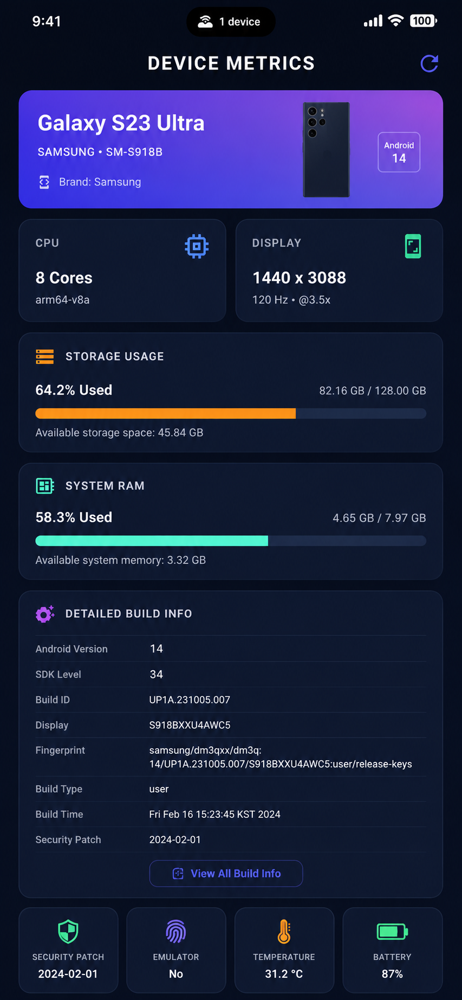
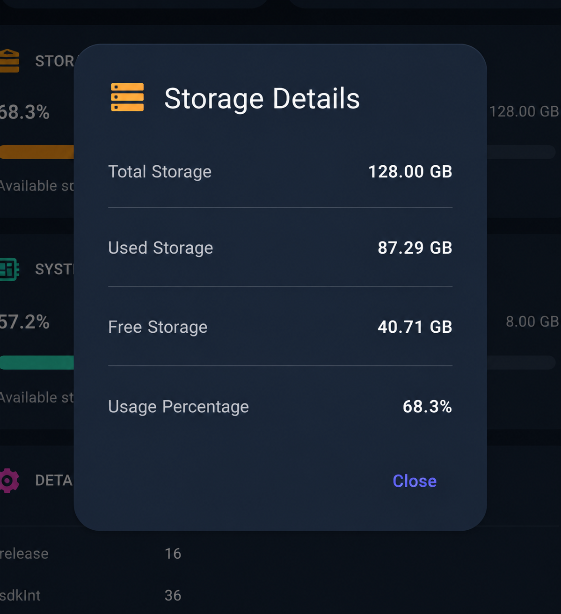
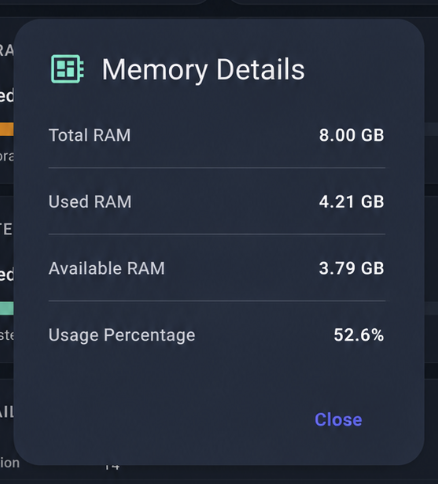

# advanced_device_info

[](https://pub.dev/packages/advanced_device_info)
[](https://flutter.dev)
[](https://pub.dev/packages/advanced_device_info)
[](LICENSE)
[](https://pub.dev/packages/advanced_device_info/score)

A production-ready Flutter plugin for retrieving comprehensive system-level device, hardware, battery, network, and security/anti-fraud inspection metrics on Android and iOS using native platform APIs.

---

# ✨ Features

## 🛡️ Security, Developer Mode & Anti-Fraud Suite
- **Developer Options Detection** (`isDeveloperMode`) - Check if Developer Mode is enabled
- **USB Debugging / ADB Detection** (`isAdbEnabled`) - Check if ADB debugging is active
- **Wireless Debugging (Wi-Fi ADB)** (`isWirelessDebuggingEnabled`) - Detect Android 11+ wireless ADB
- **USB Cable Connection State** (`isUsbConnected`) - Detect if phone is plugged into a USB cable/computer
- **Fake GPS / Mock Location Detection** (`isMockLocation`) - Detect mock location providers
- **Stay Awake While Charging** (`isStayAwake`) - Detect screen stay awake developer setting
- **USB App Package Verification** (`isVerificationOfAppsOverUsb`) - Package verification over ADB
- **Root & Jailbreak Detection** (`isRooted`, `isJailbroken`) - Multi-layer integrity check
- **Screen Lock Security** (`isDeviceSecure`) - Check if PIN, Pattern, Password, or Biometrics are set
- **Native Debugger Detection** (`isDebuggerAttached`) - Check if a debugger is actively attached
- **`isCompromised` Convenience Flag** - Combines root, jailbreak, debugger, and mock GPS checks

---

## 🔋 Battery & Power Information
- **Battery Level** (0% to 100%)
- **Charging State** (`charging`, `discharging`, `full`, `notCharging`)
- **Power Source** (`ac`, `usb`, `wireless`, `none`)
- **Battery Health** (`good`, `overheat`, `dead`, `over_voltage`, etc.)
- **Battery Temperature** in °Celsius
- **Low Power Mode / Battery Saver** status

---

## 📶 Network & Connectivity
- **Active Internet State** (Connected / Offline)
- **Connection Type** (`wifi`, `cellular`, `ethernet`, `vpn`, `none`)
- **VPN Detection** (Detect active VPN tunnels and proxy configurations)

---

## 📱 About Phone & System Specifications
- **Device Branding**: Name, Manufacturer, Brand, Model, Board, Hardware
- **OS Version & Codename**: Android Release, iOS Version, Codename, Incremental
- **Security Patch Level**: Android Security Patch date (`securityPatch`)
- **Kernel Version**: OS Kernel release (`kernelVersion`)
- **Baseband / Radio Firmware**: Cellular Radio Version (`radioVersion`)
- **Bootloader Version**: Bootloader identifier (`bootloader`)
- **CPU Architectures**: Supported ABIs (`supportedAbis`)
- **System Uptime**: Formatted uptime string (`formattedUptime`, e.g. "2d 4h 15m")
- **Build Fingerprint & ID**: Display, Fingerprint, Host, User, Build Time
- **Emulator / Simulator Detection**: Hardware & brand heuristic verification

---

## 💾 Storage Information
- Total, Used, and Free Storage in Bytes
- Usage Percentage
- **Convenience Getters**: `totalStorageGB`, `usedStorageGB`, `freeStorageGB`, `formattedUsedStorage`, etc.
- `isLowStorage(thresholdPercent: 90)`

---

## 🧠 Memory (RAM) Information
- Total, Used, and Available RAM in Bytes
- Memory Usage Percentage
- **Convenience Getters**: `totalRamGB`, `usedRamGB`, `availableRamGB`, `formattedTotalRam`, etc.
- `isLowMemory(thresholdPercent: 85)`

---

## ⚡ CPU & 🖥 Screen Information
- Architecture (`arm64`, `x86_64`, etc.) and CPU Core Count
- Physical Width & Height in Pixels
- Screen Scale / Density Scale
- Refresh Rate in Hz (e.g. 60Hz, 90Hz, 120Hz)

---

# 📦 Installation

Add this package to your `pubspec.yaml`:

```yaml
dependencies:
  advanced_device_info: ^0.0.1
```

Install packages:

```bash
flutter pub get
```

---

# ✅ Platform Support

| Platform | Support |
|----------|---------|
| Android | ✅ |
| iOS | ✅ |
| macOS | 🚧 Planned |
| Windows | 🚧 Planned |
| Linux | 🚧 Planned |
| Web | ❌ |

---

# 🚀 Quick Start

```dart
import 'package:advanced_device_info/advanced_device_info.dart';

// Get all system, battery, security, and hardware metrics at once:
final SystemInfo info = await AdvancedDeviceInfo.getSystemInfo();

// 1. Security & Anti-Fraud Checks (Great for Banking / Payment apps)
if (info.securityInfo.isDeveloperMode) {
  print("Developer Mode is ON!");
}
if (info.securityInfo.isAdbEnabled) {
  print("USB Debugging is Active!");
}
if (info.securityInfo.isUsbConnected) {
  print("USB Cable is Connected!");
}
if (info.securityInfo.isCompromised) {
  print("Device is Rooted, Jailbroken, or Debugger attached!");
}

// 2. Battery Information
print("Battery Level: ${info.batteryInfo.batteryLevel}%");
print("Charging: ${info.batteryInfo.isCharging}");
print("Power Source: ${info.batteryInfo.powerSource}");
print("Temp: ${info.batteryInfo.batteryTemperature}°C");

// 3. Network & VPN
print("Online: ${info.networkInfo.isConnected}");
print("Type: ${info.networkInfo.connectionType}");
print("VPN Active: ${info.networkInfo.isVpnActive}");

// 4. Storage & RAM Convenience Getters
print("Used Storage: ${info.storageInfo.formattedUsedStorage}"); // e.g. "54.2 GB"
print("Available RAM: ${info.memoryInfo.formattedAvailableRam}"); // e.g. "3.5 GB"
```

---

# 📚 API Reference

| Method | Description |
|---------|-------------|
| `getSystemInfo()` | Returns aggregated system, hardware, battery, and security metrics |
| `getSecurityInfo()` | Returns Root, Jailbreak, Developer Mode, ADB, USB cable, and Lock screen status |
| `getBatteryInfo()` | Returns Battery level, charging state, power source, temperature, and battery saver mode |
| `getNetworkInfo()` | Returns Connectivity state, network transport type, and active VPN detection |
| `getDeviceInfo()` | Returns Device metadata, manufacturer, model, and emulator flag |
| `getStorageInfo()` | Returns Storage capacity, used/free bytes, and GB/MB formatters |
| `getMemoryInfo()` | Returns RAM capacity, used/free bytes, and GB/MB formatters |
| `getCpuInfo()` | Returns CPU architecture and core count |
| `getScreenInfo()` | Returns Display dimensions, scale factor, and refresh rate in Hz |

---

# 📄 Example Output

```text
Device Name          : Pixel 9 Pro
Manufacturer         : Google
Model                : Pixel 9 Pro
Brand                : google
Is Emulator          : false

-- Security --
Developer Mode       : false
USB Debugging (ADB)  : false
USB Cable Connected  : false
Root / Jailbreak     : false
Passcode Secured     : true

-- Battery --
Battery Level        : 85%
Charging             : false
Power Source         : none
Temperature          : 31.5°C
Battery Saver        : false

-- Network --
Connected            : true
Type                 : wifi
VPN Active           : false

-- Storage & Memory --
Storage              : 128.0 GB (Used: 54.2 GB, Free: 73.8 GB)
RAM                  : 8.0 GB (Used: 4.5 GB, Free: 3.5 GB)

-- CPU & Screen --
CPU Cores            : 8 Cores (arm64)
Display              : 1344 x 2992 @ 120 Hz
```

---

# 📸 Screenshots

<p align="center">
  
  &nbsp;&nbsp;&nbsp;&nbsp;
  
  &nbsp;&nbsp;&nbsp;&nbsp;
  
</p>

---

# 🤝 Contributing

Contributions, bug reports, and feature requests are welcome! Feel free to check the [issues page](https://github.com/naitikharkhani7/advanced_device_info/issues).

---

# 📝 License

This project is licensed under the MIT License - see the [LICENSE](LICENSE) file for details.